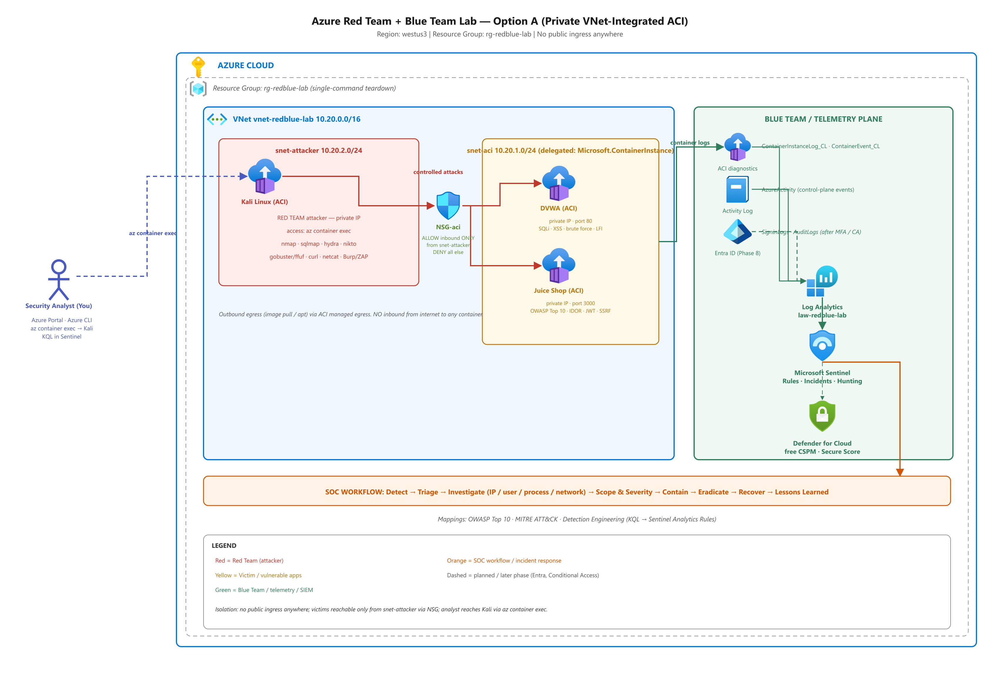

# Azure Red Team + Blue Team Cybersecurity Lab

An isolated, legal, cost-controlled Azure laboratory for hands-on Red Team (attack) and
Blue Team (detect / investigate / respond) learning using the Microsoft security stack.

> **Authorized lab only.** Every offensive action in this project targets intentionally
> vulnerable systems that I built and own inside this lab. Nothing here is intended for,
> or to be used against, any third-party or production system.



*Private VNet-integrated ACI attack, telemetry, Microsoft Sentinel, and SOC workflow architecture.*

## What this lab demonstrates

- **Red Team:** reconnaissance and web-app exploitation from an in-VNet Kali Linux container
  against intentionally vulnerable apps (DVWA + OWASP Juice Shop) running as private ACI in Azure.
- **Blue Team:** detection, investigation, and response using Microsoft Defender for Cloud,
  Defender for Endpoint, Defender XDR, Microsoft Sentinel, Entra ID logs, and KQL.
- **Detection engineering:** turning hunting queries into Sentinel analytics rules with
  MITRE ATT&CK and OWASP mappings.

## Cost model

- **Container-based build (Option A):** victims (DVWA + Juice Shop) and the Kali attacker all run
  as **private Azure Container Instances** — no VMs (the Bsv2 VM quota was 0 and a quota increase
  was denied). ACI bills per second while running and **$0** when stopped or destroyed.
- Log Analytics / Sentinel stayed within the free tiers for a home lab.
- Actual cost: a few dollars of the $200 free credit; the environment was then **torn down to $0**.
  See `docs/00-cost-and-licensing.md`.

## Architecture

The rendered diagram is shown above. See the [architecture notes](architecture/README.md),
[editable draw.io source](architecture/lab-architecture.drawio), and
[scalable SVG](architecture/lab-architecture.svg).

## Build order (phases)

> **Architecture note:** the lab uses **container-based (ACI)** victims because this PAYG
> subscription has a VM-family (Bsv2) vCPU quota of 0. Option A hardening is now applied: all
> containers are **private, VNet-integrated**, with no public ingress. The Kali attacker runs
> inside the VNet and is reached via `az container exec`. See `docs/phase-02-03-...`.

| Phase | Topic | Status |
|------|-------|--------|
| 0 | Azure account + budget alerts + cost guardrails | ✅ done |
| 1 | Resource group + Terraform skeleton | ✅ done |
| 2 | VNet / subnets / NSGs (private, Option A) | ✅ done — VNet 10.20.0.0/16, delegated subnets, NSG attacker→victim only |
| 3 | Victim apps (DVWA + Juice Shop) on ACI | ✅ done — private IPs 10.20.1.4 / 10.20.1.5 |
| 4 | Kali attacker + connectivity | ✅ done — in-VNet ACI 10.20.2.4, exec access, reachability verified |
| 5 | Windows endpoint VM (JIT, no public IP) | ⛔ blocked — Bsv2 VM quota = 0, increase **denied** by Azure (this is why the lab uses containers; not needed for web-app attacks) |
| 6 | Log Analytics workspace + logs | ✅ done — ACI diagnostics + Activity Log flowing; pipeline verified |
| 7 | Microsoft Sentinel + connectors | 🟡 partial — Sentinel + Azure Activity live; Defender connectors not fully validated |
| 8 | Entra ID: RBAC / MFA / Conditional Access | 🟡 partial — **MFA now enforced via Security Defaults** (found it was off, turned it on); RBAC/CA pending |
| 9 | Defender for Cloud + Defender for Endpoint/XDR | ⬜ mostly pending — honest coverage-gap note written; endpoint EDR blocked by Phase 5 quota |
| 10 | KQL foundations | ✅ done — Activity Log queries verified |
| 11–13 | Attack → detect → investigate → respond exercise | ✅ **SQLi (A03) complete** — full A→B→C→D cycle; log pipeline unblocked and verified |
| 14 | Sentinel detection engineering | ✅ done — scheduled analytics rule fired High incidents automatically, then tuned (150→1) |
| 15 | Incident response + remediation | ✅ done — full IR lifecycle on the SQLi incident (triage → contain → eradicate → recover → lessons) |
| 16 | Portfolio packaging + final report | ✅ done — published to GitHub; final report at `reports/final-report.md` |

### Project outcome
The SOC loop is **fully demonstrated** end to end: telemetry → KQL hunting → detection
engineering (analytics rule + tuning) → incident → investigation → response. The representative
exercise was **SQL injection (OWASP A03 / MITRE T1190)** against DVWA. See the step-by-step
walkthrough and evidence in [`documentation/`](documentation/) and the
[final report](reports/final-report.md).

> **Scope note:** the goal was demonstrating SOC capability across Azure, not exhausting all 10
> OWASP categories — one thoroughly executed exercise covers the full lifecycle. The Azure
> environment has since been **torn down to $0**.

## Repository structure

```
azure-red-blue-team-lab/
├── README.md
├── docs/                  # cost, licensing, phase guides, troubleshooting
├── architecture/          # diagrams and design notes
├── terraform/             # Infrastructure-as-Code (primary deployment method)
├── azure-cli/             # equivalent CLI scripts
├── kali/                  # local Kali setup and tool notes
├── vulnerable-app/        # DVWA / Juice Shop setup and reset procedures
├── attacks/               # 01..10 OWASP attack mini-exercises
├── detections/            # sentinel/ defender/ kql/
├── incident-response/     # IR playbooks
├── screenshots/           # portfolio evidence (NO secrets)
├── reports/               # final project report
└── lessons-learned/
```

## Safety rules

- All offensive activity is confined to this lab's intentionally vulnerable assets.
- No real credentials, secrets, tokens, or personal data are committed to this repo.
- **No public ingress anywhere:** the victim containers have private IPs only and are reachable
  solely from the attacker subnet via the NSG; the analyst reaches Kali via `az container exec`.
